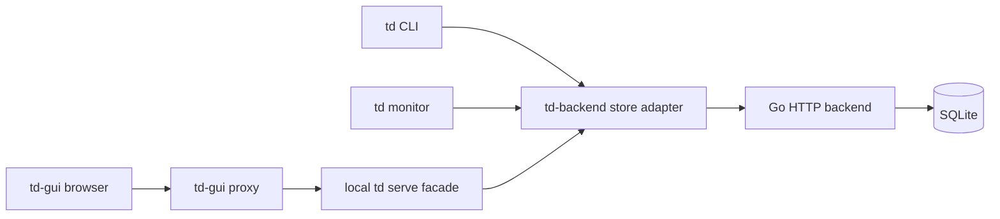

# td-backend

`td`의 세 번째 store로 사용할 HTTP backend를 설계하는 프로젝트입니다. **Go · SQLite · hexagonal architecture**를 사용하며 `td CLI`, `td monitor`, `td serve`를 통한 `td-gui` 연결을 대상으로 합니다.

현재 **단계별 구현 중**입니다. Go 서버와 SQLite 저장 adapter, Project/Session 초기화·조회·인증 API를 구현했으며 이슈/workflow와 td client 연동을 진행합니다. 아래 td 명령은 client adapter 구현 후 제공할 목표 사용법입니다. 완료 범위는 [구현 진행 기록](docs/implementation-progress.md)과 td task 상태를 확인합니다.

## 목표 사용법

```sh
# 신규 Project 생성: 서버가 ID를 발급하고 td가 저장
td init --store=td-backend,http://localhost:7000

# 다른 checkout에서 기존 Project 연결
td init --store=td-backend,http://localhost:7000 \
  --project-id=prj_019a7a6e-8c00-7d42-9f23-8c5e7a1b6d90

# 동일한 원격 데이터 사용
td create "Implement the remote store adapter"
td monitor
td serve
td-gui
```

최초 init에는 Project ID가 필요 없습니다. 생성 응답의 ID를 `.todos/config.json`에 저장하고 이후 init에서는 재사용합니다. 기존 Project 연결에는 전체 ID를 지정합니다. 이미 저장된 연결과 다른 URL/ID가 주어지면 자동으로 덮어쓰지 않습니다. 현재 td는 `td-backend` store 및 `--project-id` 옵션을 지원하지 않습니다.

## 연결 구조



GUI의 기존 `/v1/*` 경로와 응답 envelope는 로컬 `td serve`가 유지합니다. 원격 backend는 `/v1/projects/{project_id}/*`로 Project를 구분합니다. backend가 모든 Session에 동일한 작업 상태·history·board를 제공하고, focus는 각 Session에 귀속합니다. 로컬 serve token과 원격 backend token은 구분합니다.

## Backend 설계

| Module / adapter | 책임 |
| --- | --- |
| Domain | workflow, review policy, review basis, 관계 불변 조건 |
| Application | typed command/query, 권한, transaction, receipt·audit·undo 조합 |
| Ports | UnitOfWork, ReadStore, repositories, Authenticator, ReceiptEncoder |
| HTTP adapter | OpenAPI routes, DTO, headers, 오류, SSE |
| SQLite adapter | SQL/migration, revision 검사, snapshot, 단일 파일 transaction |
| Composition root | 설정과 adapter 조립, startup/shutdown |

Domain과 application은 HTTP·SQLite 구현을 import하지 않습니다. 모든 Project를 하나의 SQLite 파일에 저장하고 project-scoped 복합 FK로 관계를 제한합니다. writer 1개와 제한된 reader pool을 사용하며 WAL, immediate write transaction, 일관된 read snapshot을 적용합니다.

이슈 변경, review supersession, cascade, audit, operation receipt와 change token을 한 transaction으로 commit합니다. `If-Match`로 관측 revision을 검증하고 `Idempotency-Key`로 response 유실 뒤 중복 변경을 방지합니다. SSE는 `refresh`/`ping` 신호이며 client가 화면을 다시 조회합니다.

## ID 규칙

| 값 | 형식 | 생성 주체 |
| --- | --- | --- |
| Project ID | `prj_` + 소문자 UUIDv7, 40자 | backend |
| Init / operation key | 소문자 UUIDv4, 36자 | td client / serve facade |
| Internal operation row ID | 소문자 UUIDv7, 36자 | backend; 외부 ID와 별도 |

Project ID는 생성 후 불변이며 이름·Git remote·경로에서 파생하지 않습니다. 같은 init key로 재시도하면 같은 Project ID를 반환합니다. 상세 pattern, collision 처리와 retry 규칙은 [ID 정책](docs/id-policy.md)을 따릅니다. Issue/Board/Session 등 기존 td resource ID의 형식을 변경하는 결정은 포함하지 않습니다.

## 설계 산출물

| 파일 | 내용 |
| --- | --- |
| [swagger.json](swagger.json) | 원격 backend, `http://localhost:7000`, 49개 path / 63개 operation |
| [api/td-serve.swagger.json](api/td-serve.swagger.json) | 로컬 serve facade와 GUI 호환 HTTP 계약 |
| [docs/api-design.md](docs/api-design.md) | endpoint, session, 원자성, monitor 및 GUI 연결 |
| [docs/backend-architecture.md](docs/backend-architecture.md) | Go package, ports/adapters, domain, transaction, 운영·검증 |
| [docs/sqlite-schema.sql](docs/sqlite-schema.sql) | 실행 검증 가능한 21개 테이블 DDL 초안; production migration 전 단계 |
| [docs/id-policy.md](docs/id-policy.md) | Project ID와 init/operation key 생성 규칙 |
| [docs/implementation-plan.md](docs/implementation-plan.md) | td feature/task, dependencies와 완료 기준 |
| [docs/implementation-progress.md](docs/implementation-progress.md) | 구현한 범위와 검증 결과 |
| [docs/store-integration.md](docs/store-integration.md) | td 소스 분석과 CLI/monitor/serve adapter 수정 지점 |
| [CONTEXT.md](CONTEXT.md) | 도메인 용어 |
| [docs/adr/0001-single-sqlite-transaction-boundary.md](docs/adr/0001-single-sqlite-transaction-boundary.md) | 단일 SQLite 파일과 transaction 결정 |
| [api/model-schemas.json](api/model-schemas.json) | 분석한 td commit의 model/DTO schema snapshot |

OpenAPI는 [3.0.3](https://spec.openapis.org/oas/v3.0.3) 형식입니다. `x-status: proposed`와 `x-origin`이 설계 상태 및 원본 코드와의 관계를 표시합니다. `adapted`는 기존 기능을 참고했다는 뜻이며 기존 서버의 모든 wire 동작과 동일하다는 뜻은 아닙니다.

## Swagger UI로 보기

Docker가 설치되어 있으면 다음처럼 JSON을 읽기 전용으로 연결할 수 있습니다. [Swagger UI 공식 설치 문서](https://swagger.io/docs/open-source-tools/swagger-ui/usage/installation/).

```sh
docker run --rm \
  -p 127.0.0.1:8080:8080 \
  -v "$PWD/swagger.json:/spec/swagger.json:ro" \
  -e SWAGGER_JSON=/spec/swagger.json \
  docker.swagger.io/swaggerapi/swagger-ui
```

브라우저에서 `http://127.0.0.1:8080`을 엽니다. serve 명세는 volume의 파일을 `api/td-serve.swagger.json`으로 바꾸면 됩니다. 구현된 backend endpoint는 인증 정보를 설정해 실행할 수 있습니다. 아직 구현 중인 endpoint와 serve 명세는 설계 계약입니다.

## 명세 재생성 및 검증

Go 서버는 다음 명령으로 빌드·실행·검증합니다. 기본 DB는 `./data/td-backend.db`, listen은 `127.0.0.1:7000`입니다. 아직 구현하지 않은 API는 사용할 수 없습니다.

```sh
make build
make test-race
make check
# 최초 한 번 생성해 보관하고, 재시작에서는 동일한 값을 사용
export TD_BACKEND_BOOTSTRAP_TOKEN="$(openssl rand -hex 32)"
./bin/td-backend --addr 127.0.0.1:7000 --db ./data/td-backend.db
curl http://127.0.0.1:7000/healthz
```

Bootstrap token은 32자 이상이며 digest만 SQLite에 저장합니다. 설정 token을 변경하면 기존 bootstrap credential은 폐기됩니다. `/healthz` 외 구현된 API는 bearer token을 요구합니다. 현재 project·Session 등록/조회, Issue CRUD와 workflow/review/handoff, dependency·file·comment·log·activity, Board CRUD·TDQ 카드 조회·pin/unpin·move, Note CRUD·pin/archive, WorkSession start/read/tag/end와 Session Focus API를 구현했습니다. 일반 TDQ query·목록 검색과 Monitor snapshot 조회도 구현했습니다. Stats·labels·프로젝트 활동 조회, Undo·SSE와 CLI 통합은 진행 중입니다. 구현 및 검증 기록은 [진행 기록](docs/implementation-progress.md)을 참고하세요. Session 등록을 제외한 project-scoped 조회는 등록된 `X-TD-Session`도 필요합니다.

OpenAPI 및 DDL 명세는 Python 3와 개발 의존성으로 검증합니다.

```sh
python3 -m venv .venv
.venv/bin/pip install -r requirements-dev.txt

python3 scripts/generate_openapi.py
.venv/bin/python scripts/validate_openapi.py
python3 scripts/validate_sqlite_design.py
```

OpenAPI 검사는 두 명세의 구조/참조, Project ID 규칙, GUI 필수 30개 route/method, envelope와 SSE 계약을 확인합니다. SQLite 검사는 실제 임시 DB에서 프로젝트 격리, enum/points, active review, receipt uniqueness, rollback, WAL snapshot, stale revision과 receipt 재조회 등을 확인합니다. Python SQLite 검증과 실제 Go driver/application의 통합 검증은 별도입니다.

## 구현 계획과 범위

[구현 계획](docs/implementation-plan.md)은 현재 이 저장소의 `gh-issue` store에 td feature/task로 등록합니다. 이는 앞으로 제공할 `td-backend` store와 별개인 현재 프로젝트의 작업 추적 설정입니다. td 기본 명령으로 조회합니다.

```sh
td list --all
td ready
td show <issue-id>
td dep <issue-id>
```

구현은 backend 저장/identity → observed CRUD와 receipt → workflow/review/history/관계 → query/monitor/boards/notes/work sessions/undo/SSE → td CLI와 monitor/serve/GUI adapter 및 전체 통합 검증 순으로 진행합니다.

기존 SQLite·GitHub 데이터의 import/export·migration과 기존 sync push/pull 프로토콜은 초기 API 범위에 포함하지 않습니다. local process/worktree path, git snapshot 수집, 개인 pane/filter/cursor와 active work-session 선택은 client가 관리합니다.
