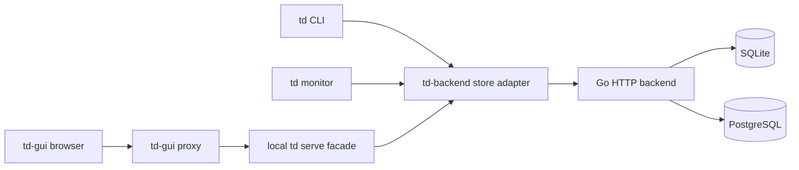

# td-backend

`td`의 세 번째 store로 사용할 HTTP backend입니다. **Go · SQLite/PostgreSQL · hexagonal architecture**를 사용하며 `td CLI`, `td monitor`, `td serve`와 `td-gui`를 연결합니다.

서버와 td client adapter는 구현되어 있습니다. `td`의 원격 store 변경은 [CLI 브랜치](https://github.com/yoophi/td/tree/feat/td-backend-store)에 있습니다. 검증 범위와 남은 작업은 [통합 검증 기록](docs/integration-report.md)과 [구현 진행 기록](docs/implementation-progress.md)을 확인하세요.

## 사용법

Homebrew를 사용한다면 `yoophi/tap`에서 서버를 설치할 수 있습니다.
릴리스 버전은 `YYYY.M.PATCH` 형식의 CalVer를 따릅니다(예: `2026.10.0`).

```sh
brew install yoophi/tap/td-backend
export TD_BACKEND_BOOTSTRAP_TOKEN="$(openssl rand -hex 32)"
td-backend --addr 127.0.0.1:7000 --db ./data/td-backend.db
```

재시작할 때는 같은 bootstrap token을 사용해야 기존 credential이 유지됩니다. SQLite 파일 경로는 서버 프로세스의 현재 디렉터리를 기준으로 해석하므로, 운영할 때는 `--db`에 지속적으로 사용할 경로를 지정하세요. 설치한 서버의 상태는 `curl http://127.0.0.1:7000/healthz`로 확인할 수 있습니다.

PostgreSQL 16 이상을 사용하려면 전용 데이터베이스와 schema를 만들고, 해당 schema에 테이블 생성·조회·수정 권한이 있는 계정을 사용합니다. 연결 문자열에는 운영 환경에 맞는 TLS 설정을 포함하세요.

```sh
export TD_BACKEND_BOOTSTRAP_TOKEN='재시작에도 동일하게 사용할 32자 이상 token'
export TD_BACKEND_DB_ENGINE=postgres
export TD_BACKEND_DATABASE_URL='postgres://td_backend@db.example/td_backend?sslmode=verify-full'
td-backend --addr 127.0.0.1:7000
```

`--db-engine=postgres`도 사용할 수 있으며 기본 엔진은 `sqlite`입니다. PostgreSQL에서는 `--db`, `TD_BACKEND_DB_PATH`, `--readers`, `--busy-timeout`을 함께 지정할 수 없습니다. SQLite에서는 `TD_BACKEND_DATABASE_URL`을 지정할 수 없습니다. 서버 시작 시 선택한 엔진의 migration을 자동 적용하며, 두 서버가 같은 PostgreSQL 데이터베이스를 공유할 수 있습니다. **엔진을 바꾸면 빈 데이터베이스로 시작하며 기존 Project와 데이터는 자동으로 옮겨지지 않습니다.** 데이터 이전은 별도 export/import 절차가 필요합니다. SQLite는 실행 중인 서버를 멈추고 DB/WAL 파일을 일관되게 백업하거나 SQLite backup API를 사용하세요. PostgreSQL은 정기적으로 `pg_dump -Fc -d td_backend -f td_backend.dump`로 백업하고 별도 DB에 `pg_restore`하여 복원 검증을 수행하세요.

```sh
# 신규 Project 생성: 서버가 ID를 발급하고 td가 저장
export TD_BACKEND_TOKEN='서버의 bootstrap token'
td init --store=td-backend,http://localhost:7000

# 다른 checkout에서 기존 Project 연결
td init --store=td-backend,http://localhost:7000 \
  --project-id=prj_019a7a6e-8c00-7d42-9f23-8c5e7a1b6d90

# 동일한 원격 데이터 사용
td create "Implement the remote store adapter"
td monitor
td serve
td-gui
```

최초 init에는 Project ID가 필요 없습니다. 생성 응답의 ID를 `.todos/config.json`에 저장하고 이후 init에서는 재사용합니다. 기존 Project 연결에는 전체 ID를 지정합니다. 이미 저장된 연결과 다른 URL/ID가 주어지면 자동으로 덮어쓰지 않습니다. `approve`는 직접 승인과 `--record-only` 기록, 단일 후보 자동 선택 및 `--all` 일괄 처리를 지원합니다. `unstart --session/--stale`은 기본적으로 미리보기이며 `--force`로 해제합니다.

## 연결 구조



GUI의 기존 `/v1/*` 경로와 응답 envelope는 로컬 `td serve`가 유지합니다. 원격 backend는 `/v1/projects/{project_id}/*`로 Project를 구분합니다. backend가 모든 Session에 동일한 작업 상태·history·board를 제공하고, focus는 각 Session에 귀속합니다. 로컬 serve token과 원격 backend token은 구분합니다.

## Backend 설계

| Module / adapter | 책임 |
| --- | --- |
| Domain | workflow, review policy, review basis, 관계 불변 조건 |
| Application | typed command/query, 권한, transaction, receipt·audit·undo 조합 |
| Ports | UnitOfWork, ReadStore, repositories, Authenticator, ReceiptEncoder |
| HTTP adapter | OpenAPI routes, DTO, headers, 오류, SSE |
| SQLite adapter | SQL/migration, revision 검사, snapshot, 단일 파일 transaction |
| PostgreSQL adapter | SQL/migration, serializable write, repeatable-read snapshot |
| Composition root | 설정과 adapter 조립, startup/shutdown |

Domain과 application은 HTTP·DB adapter 구현을 import하지 않습니다. 모든 Project를 선택한 한 데이터베이스에 저장하고 project-scoped 복합 FK로 관계를 제한합니다. SQLite는 writer 1개와 제한된 reader pool, WAL, immediate write transaction을 사용합니다. PostgreSQL은 serializable write와 repeatable-read snapshot을 사용합니다.

이슈 변경, review supersession, cascade, audit, operation receipt와 change token을 한 transaction으로 commit합니다. `If-Match`로 관측 revision을 검증하고 `Idempotency-Key`로 response 유실 뒤 중복 변경을 방지합니다. SSE는 `refresh`/`ping` 신호이며 client가 화면을 다시 조회합니다.

Issue 생성의 `blocks`에는 대상 Issue ID와 관측 revision을 전달합니다. 새 Issue와 대상들의 의존성 변경은 한 transaction으로 처리하며, 충돌이나 순환이 있으면 전체를 취소합니다. CLI `create --blocks`는 서버의 `create_blocks` capability를 확인하고 이 계약을 사용합니다.

삭제·복원 API는 선택적인 `reason` 본문을 받습니다. 사유가 있으면 변경과 progress log, Undo effect, receipt를 같은 DB transaction으로 저장합니다. 삭제 응답에는 `deleted` 확인값과 새 Issue revision이 포함됩니다.

## ID 규칙

| 값 | 형식 | 생성 주체 |
| --- | --- | --- |
| Project ID | `prj_` + 소문자 UUIDv7, 40자 | backend |
| Init / operation key | 소문자 UUIDv4, 36자 | td client / serve facade |
| Internal operation row ID | 소문자 UUIDv7, 36자 | backend; 외부 ID와 별도 |

Project ID는 생성 후 불변이며 이름·Git remote·경로에서 파생하지 않습니다. 같은 init key로 재시도하면 같은 Project ID를 반환합니다. 상세 pattern, collision 처리와 retry 규칙은 [ID 정책](docs/id-policy.md)을 따릅니다. Issue/Board/Session 등 기존 td resource ID의 형식을 변경하는 결정은 포함하지 않습니다.

## 설계 산출물

| 파일 | 내용 |
| --- | --- |
| [swagger.json](swagger.json) | 원격 backend, `http://localhost:7000`, 54개 path / 69개 operation |
| [api/td-serve.swagger.json](api/td-serve.swagger.json) | 로컬 serve facade와 GUI 호환 HTTP 계약 |
| [docs/api-design.md](docs/api-design.md) | endpoint, session, 원자성, monitor 및 GUI 연결 |
| [docs/backend-architecture.md](docs/backend-architecture.md) | Go package, ports/adapters, domain, transaction, 운영·검증 |
| [docs/postgresql-engine-design.md](docs/postgresql-engine-design.md) | SQLite/PostgreSQL 엔진 선택, migration 및 transaction 설계 |
| [docs/sqlite-schema.sql](docs/sqlite-schema.sql) | 실행 검증 가능한 21개 테이블 DDL 초안; production migration 전 단계 |
| [docs/id-policy.md](docs/id-policy.md) | Project ID와 init/operation key 생성 규칙 |
| [docs/implementation-plan.md](docs/implementation-plan.md) | td feature/task, dependencies와 완료 기준 |
| [docs/implementation-progress.md](docs/implementation-progress.md) | 구현한 범위와 검증 결과 |
| [docs/integration-report.md](docs/integration-report.md) | 실제 서버·CLI·GUI 통합 검증 |
| [docs/store-integration.md](docs/store-integration.md) | td 소스 분석과 CLI/monitor/serve adapter 수정 지점 |
| [CONTEXT.md](CONTEXT.md) | 도메인 용어 |
| [docs/adr/0001-single-sqlite-transaction-boundary.md](docs/adr/0001-single-sqlite-transaction-boundary.md) | 단일 SQLite 파일과 transaction 결정 |
| [api/model-schemas.json](api/model-schemas.json) | 분석한 td commit의 model/DTO schema snapshot |

OpenAPI는 [3.0.3](https://spec.openapis.org/oas/v3.0.3) 형식입니다. `x-status: proposed`와 `x-origin`이 설계 상태 및 원본 코드와의 관계를 표시합니다. `adapted`는 기존 기능을 참고했다는 뜻이며 기존 서버의 모든 wire 동작과 동일하다는 뜻은 아닙니다.

## Swagger UI로 보기

Docker가 설치되어 있으면 다음처럼 JSON을 읽기 전용으로 연결할 수 있습니다. [Swagger UI 공식 설치 문서](https://swagger.io/docs/open-source-tools/swagger-ui/usage/installation/).

```sh
docker run --rm \
  -p 127.0.0.1:8080:8080 \
  -v "$PWD/swagger.json:/spec/swagger.json:ro" \
  -e SWAGGER_JSON=/spec/swagger.json \
  docker.swagger.io/swaggerapi/swagger-ui
```

브라우저에서 `http://127.0.0.1:8080`을 엽니다. serve 명세는 volume의 파일을 `api/td-serve.swagger.json`으로 바꾸면 됩니다. 인증이 필요한 backend endpoint는 Swagger UI에서 bearer token을 설정합니다.

## 명세 재생성 및 검증

Go 서버는 다음 명령으로 빌드·실행·검증합니다. 기본 DB는 `./data/td-backend.db`, listen은 `127.0.0.1:7000`입니다.

```sh
make build
make test-race
make check
# 최초 한 번 생성해 보관하고, 재시작에서는 동일한 값을 사용
export TD_BACKEND_BOOTSTRAP_TOKEN="$(openssl rand -hex 32)"
./bin/td-backend --addr 127.0.0.1:7000 --db ./data/td-backend.db
curl http://127.0.0.1:7000/healthz
```

Bootstrap token은 32자 이상이며 digest만 선택한 DB에 저장합니다. 설정 token을 변경하면 기존 bootstrap credential은 폐기됩니다. `/healthz` 외 API는 bearer token을 요구합니다. Project·Session 등록, Issue CRUD/workflow/review/handoff, 관계·파일·활동, Board, Note, Work Session, Focus, TDQ query, Monitor snapshot, Stats·labels, operation audit·Undo, 변경 token과 refresh/ping SSE를 지원합니다. Session 등록을 제외한 project-scoped 조회는 등록된 `X-TD-Session`도 필요합니다.

PostgreSQL 통합 테스트에는 폐기 가능한 DB URL을 지정합니다. 테스트는 임의 schema를 만들고 삭제하므로 테스트 계정에 해당 권한이 필요합니다.

```sh
TD_BACKEND_TEST_DATABASE_URL='postgres://postgres@127.0.0.1:5432/td_backend?sslmode=disable' go test ./...
```

OpenAPI 및 DDL 명세는 Python 3와 개발 의존성으로 검증합니다.

```sh
python3 -m venv .venv
.venv/bin/pip install -r requirements-dev.txt

python3 scripts/generate_openapi.py
.venv/bin/python scripts/validate_openapi.py
python3 scripts/validate_sqlite_design.py
```

OpenAPI 검사는 두 명세의 구조/참조, Project ID 규칙, GUI 필수 30개 route/method, envelope와 SSE 계약을 확인합니다. SQLite 검사는 실제 임시 DB에서 프로젝트 격리, enum/points, active review, receipt uniqueness, rollback, WAL snapshot, stale revision과 receipt 재조회 등을 확인합니다. Python SQLite 검증과 실제 Go driver/application의 통합 검증은 별도입니다.

## 구현 계획과 범위

[구현 계획](docs/implementation-plan.md)은 현재 이 저장소의 `gh-issue` store에 td feature/task로 등록합니다. 이는 앞으로 제공할 `td-backend` store와 별개인 현재 프로젝트의 작업 추적 설정입니다. td 기본 명령으로 조회합니다.

```sh
td list --all
td ready
td show <issue-id>
td dep <issue-id>
```

구현은 backend 저장/identity → observed CRUD와 receipt → workflow/review/history/관계 → query/monitor/boards/notes/work sessions/undo/SSE → td CLI와 monitor/serve/GUI adapter 및 전체 통합 검증 순으로 진행합니다.

기존 SQLite·GitHub 데이터의 import/export·migration과 기존 sync push/pull 프로토콜은 초기 API 범위에 포함하지 않습니다. local process/worktree path, git snapshot 수집, 개인 pane/filter/cursor와 active work-session 선택은 client가 관리합니다.
