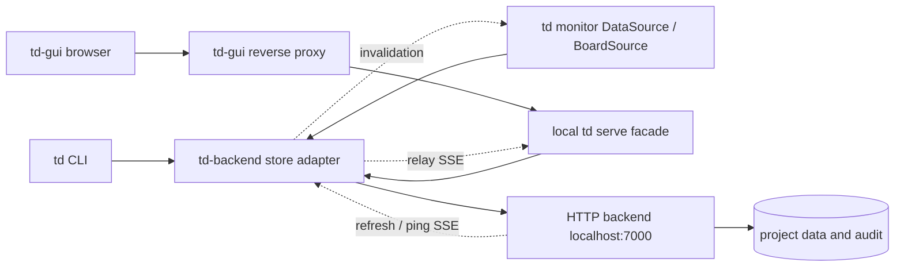

# API 설계 및 연결 경계

## 분석 기준

td 기준 commit: [`c64d7873`](https://github.com/yoophi/td/tree/c64d7873d8f555dd49875e34e6b39ae5257e2e0c). GUI 기준 commit: [`f5b2abaf`](https://github.com/madic-creates/td-gui/tree/f5b2abaf49956b29d47510a17ab4ec5bc7f2716f). 이 문서의 endpoint는 **신규 구현을 위한 제안**입니다.

핵심 근거는 td의 [Reader](https://github.com/yoophi/td/blob/c64d7873d8f555dd49875e34e6b39ae5257e2e0c/internal/issuestore/reader.go), [observed writer](https://github.com/yoophi/td/blob/c64d7873d8f555dd49875e34e6b39ae5257e2e0c/internal/issuestore/writer.go), [domain models](https://github.com/yoophi/td/blob/c64d7873d8f555dd49875e34e6b39ae5257e2e0c/internal/models/models.go), [serve DTO와 validation](https://github.com/yoophi/td/blob/c64d7873d8f555dd49875e34e6b39ae5257e2e0c/internal/serve/response.go), [review policy](https://github.com/yoophi/td/blob/c64d7873d8f555dd49875e34e6b39ae5257e2e0c/internal/reviewpolicy/policy.go)입니다. 기존 multi-project REST API도 [project_routes.go](https://github.com/yoophi/td/blob/c64d7873d8f555dd49875e34e6b39ae5257e2e0c/internal/api/project_routes.go)에 존재하지만, 원격 store adapter가 없고 여기서 제안하는 headers·원자성·응답 전체 필드를 제공하는 계약은 아닙니다.

## 연결 구조

GUI 연결은 기존 `/v1/*` 경로를 유지합니다. `td serve`가 저장된 project ID를 원격 `/v1/projects/{project_id}/*` 경로에 넣고 자기 web session과 backend token을 전달합니다. 브라우저는 기존처럼 td-gui origin만 호출합니다. td-gui proxy가 주입하는 **로컬 serve token**과 adapter의 **backend token**은 별개입니다. `/health`는 기존처럼 인증 없이 probe할 수 있고 `/v1/*`의 로컬 인증은 유지합니다.

## 초기화와 요청 identity

1. 최초 init에서 로컬에 init UUID를 기록합니다. `GET /healthz`, `GET /v1/capabilities`로 호환성을 확인합니다.
2. `POST /v1/projects`에 init UUID를 `Idempotency-Key`로 보냅니다. 응답의 `data.project.id`를 config에 기록합니다. URL과 project ID가 이미 있으면 재사용합니다.
3. 각 CLI context 및 serve web context는 `POST /v1/projects/{project_id}/sessions`로 등록합니다. 이 요청에는 아직 `X-TD-Session`이 필요하지 않습니다.
4. 이후 project 요청은 `Authorization: Bearer …`, `X-TD-Session`을 전달합니다. 서버는 session이 인증된 actor에게 속하고 프로젝트에 접근 가능한지 확인합니다.
5. 변경 요청은 `Idempotency-Key`, 기존 aggregate를 변경할 때는 `If-Match`도 전달합니다. operations 조회의 operation ID는 이 key입니다.

session은 branch/agent/context별 attribution입니다. session ID를 바꾸는 것만으로 review 독립성이 생기지 않습니다. 서버가 전체 implementation history와 프로젝트 review policy를 평가해야 합니다. 인증 방식의 token 발급·사용자 초대 API는 이 store 계약 범위 밖이며 배포 환경에서 별도로 제공해야 합니다.

## Endpoint 그룹

아래 경로는 별도 표시가 없으면 `/v1/projects/{project_id}` 기준입니다. 모든 성공 JSON은 `{ "ok": true, "data": … }`, 실패는 `{ "ok": false, "error": { "code", "message", "details" } }`입니다. 상세 body와 status는 swagger JSON이 기준입니다.

| 기능 | endpoint | 소비자 |
| --- | --- | --- |
| 서버 확인 / 초기화 | `GET /healthz`, `GET /v1/capabilities`, `GET/POST /v1/projects` | init |
| session | `GET/POST /sessions` | CLI / serve / monitor |
| 이슈 조회·CRUD | `GET/POST /issues`, `GET/PATCH/DELETE /issues/{issue_id}`, `POST …/restore` | 세 소비자 공통 |
| workflow | `POST …/start`, `unstart`, `review`, `approve`, `reject`, `block`, `unblock`, `close`, `reopen`, `status` | CLI / monitor / GUI |
| review 기록 | `POST …/reviews` | record-only review |
| history | `GET/POST …/activity`, `POST …/logs`, `POST …/handoffs`, comments 추가/삭제 | CLI / monitor / GUI |
| 관계 | dependency 추가/삭제, `PUT …/files` | CLI / 상세 화면 |
| 보드 | CRUD, `POST …/issues`, `POST …/move`, position 삭제, `POST …/visit` | monitor / GUI |
| monitor | `GET /monitor`, `GET/PUT /focus`, `GET /stats`, `GET /labels` | TUI / serve |
| 변경 감지 | `GET /changes`, `GET /events` | monitor polling / SSE, GUI SSE |
| TDQ | `GET /query?q=…` | CLI / 보드 / GUI subprocess |
| 메모 | `/notes` CRUD, pinned / archived 수정 | CLI / monitor |
| work session | `/work-sessions`, issue tagging, `…/end` | ws CLI |
| audit / undo | `GET /operations`, `GET /operations/{operation_id}`, `POST …/undo` | write 복구 / td undo |

## 읽기 및 monitor 계약

Reader.List는 삭제되지 않은 **완전한 이슈 집합**이 필요합니다. 기존 GUI list handler는 description/acceptance를 생략하는 최적화가 있으므로 그대로 store Reader에 사용하면 데이터가 부족합니다. 새 `/issues`는 전체 필드를 반환합니다. 기본 목록은 closed만 제외하며 blocked/in_review는 포함합니다. closed를 포함하려면 `include_closed=true`를 보냅니다. 페이지별 `change_token`이 달라지면 adapter가 전체 조회를 다시 시작해야 합니다. 단순히 첫 200개를 Reader.List 결과로 반환하면 안 됩니다. [현재 Reader 계약](https://github.com/yoophi/td/blob/c64d7873d8f555dd49875e34e6b39ae5257e2e0c/internal/issuestore/reader.go#L23), [현재 list 최적화](https://github.com/yoophi/td/blob/c64d7873d8f555dd49875e34e6b39ae5257e2e0c/internal/serve/handlers_read.go).

`GET /monitor`는 `MonitorDTO`를 반환합니다. 요청 session 기준 focus, in-progress, activity, recent handoffs, active sessions와 다음 task 분류를 한 snapshot에서 계산합니다: reviewable, needs_rework, in_progress, ready, pending_review, ready_to_close, pending_other, blocked, closed. 각 분류는 실제 td 정책을 재사용해야 하고 단순 status 분류로 대체할 수 없습니다. `review_verification_required`도 유지합니다. adapter는 이를 `RefreshDataMsg`로 변환하고 상세·편집·review·notes 및 보드 capability interface를 제공합니다. [DTO 원본](https://github.com/yoophi/td/blob/c64d7873d8f555dd49875e34e6b39ae5257e2e0c/internal/serve/response.go#L559), [monitor data source](https://github.com/yoophi/td/blob/c64d7873d8f555dd49875e34e6b39ae5257e2e0c/pkg/monitor/github_data_source.go).

SSE는 delta가 아닌 invalidate 신호입니다. `refresh` payload는 `{change_token,timestamp}`, `ping`은 `{change_token}`, event id는 token입니다. reconnect에서 현재 token을 보내 재조회하게 하며 history 전체 replay를 약속하지 않습니다. terminal monitor는 현재 interval polling을 사용하므로 adapter에 SSE 소비를 추가하기 전에는 `/monitor` polling을 사용합니다. `td serve`는 backend 이벤트를 로컬 `/v1/events`로 relay합니다. [GUI 이벤트 소비](https://github.com/madic-creates/td-gui/blob/f5b2abaf49956b29d47510a17ab4ec5bc7f2716f/web/src/api/useLiveUpdates.ts).

보드 position 입력은 명령별로 다릅니다. `POST /boards/{id}/issues`의 `position`은 1부터 시작하는 삽입 slot입니다. 반환 position은 sparse sort key여서 그대로 slot으로 보내면 안 됩니다. `POST …/move`는 `before_id` 기준 이동입니다. query/name 변경과 builtin 삭제는 제한하지만 builtin board의 position/view mode는 변경할 수 있습니다. [position 입력](https://github.com/yoophi/td/blob/c64d7873d8f555dd49875e34e6b39ae5257e2e0c/internal/serve/handlers_write.go#L550), [move 입력](https://github.com/yoophi/td/blob/c64d7873d8f555dd49875e34e6b39ae5257e2e0c/internal/serve/handlers_board_move.go).

## 쓰기 원자성 및 복구

기존 store의 observed writer를 유지합니다. GET의 `issue.revision`과 strong ETag는 같은 opaque revision을 나타냅니다. PATCH/workflow/comment/dependency/file 작업은 issue aggregate의 ETag, board 작업은 board ETag, note 작업은 note ETag를 사용합니다. history/관계 변경도 해당 aggregate revision을 갱신합니다. stale revision은 412, 누락은 428이며 어떤 효과도 남기지 않습니다.

새 backend에서는 revision 검사, domain 변경, session history, review supersession, parent/blocked cascade, audit, durable receipt, change token을 한 트랜잭션으로 commit하도록 요구합니다. 이 보장은 기존 GitHub store의 best-effort write보다 강한 **신규 설계 요구**입니다. handoff와 자동 review 제출도 한 transaction으로 묶습니다.

Idempotency key는 actor+project 기준으로 프로젝트 수명 동안 보존하고 session/method/path/body/If-Match의 fingerprint를 기록합니다. 같은 요청 재전송은 revision 검사 전에 원래 HTTP status/body/ETag를 반환합니다. 다른 요청에 key를 재사용하면 409입니다. 네트워크 유실 시 receipt를 먼저 조회하거나 정확히 같은 요청을 같은 key로 재전송합니다. receipt 404만으로 실행이 실패했다고 단정하면 안 됩니다. 새 key로 무조건 재실행하면 중복 effect가 생깁니다.

Undo는 기록된 모든 after-revision을 검사한 뒤 inverse를 한 transaction으로 적용합니다. 이후 다른 변경이 있으면 409로 거부합니다. session involvement와 review audit 기록은 이력으로 보존하고, 데이터 되돌림이 과거 승인을 다시 유효하게 만들어서는 안 됩니다.

## td-gui 호환성 및 남은 구현

GUI의 [queries](https://github.com/madic-creates/td-gui/blob/f5b2abaf49956b29d47510a17ab4ec5bc7f2716f/web/src/api/queries.ts), [mutations](https://github.com/madic-creates/td-gui/blob/f5b2abaf49956b29d47510a17ab4ec5bc7f2716f/web/src/api/mutations.ts), [board 조회](https://github.com/madic-creates/td-gui/blob/f5b2abaf49956b29d47510a17ab4ec5bc7f2716f/web/src/api/boards.ts)를 확인했습니다. 댓글은 `text`, dependency는 `depends_on`, record-only review는 `summary`를 사용합니다. 이슈 상세의 reviews와 active_review는 `data.issue` 아래에 있어야 합니다. 오류의 message와 details.fields를 그대로 전달합니다.

GUI는 현재 If-Match/Idempotency-Key를 보내지 않습니다. 로컬 serve facade가 read 후 revision과 요청 UUID를 backend에 전달하도록 제안합니다. 이는 **backend 호출 사이의 충돌**은 감지하지만 **사용자가 오래된 GUI 화면에서 편집한 것**까지 감지하지는 못합니다. 그 보호가 필요하면 GUI에서 관측 revision을 If-Match로 보내는 후속 변경이 필요합니다. browser의 명시적 If-Match가 있으면 serve는 그 값을 보존해야 합니다.

`/gui/query`, `/gui/status`, `/gui/about`는 td-gui가 소유합니다. query와 status는 실제 td subprocess를 실행하므로 serve API만 연결해도 이 기능들이 동작하는 것은 아닙니다. CLI의 `td query`, `td unstart`, `td update --status`도 remote dispatch가 필요합니다. `/gui/about`는 GUI process 정보이므로 backend endpoint로 옮기지 않습니다. [GUI query handler](https://github.com/madic-creates/td-gui/blob/f5b2abaf49956b29d47510a17ab4ec5bc7f2716f/internal/tdquery/tdquery.go), [status handler](https://github.com/madic-creates/td-gui/blob/f5b2abaf49956b29d47510a17ab4ec5bc7f2716f/internal/tdstatus/tdstatus.go).

이번 산출물은 명세입니다. 이후 backend 서버, CLI store/config/session dispatch, monitor DataSource/BoardSource와 capability adapter, serve forwarding/SSE relay를 구현해야 실제 연결됩니다. import/export/기존 SQLite·GitHub 데이터 migration과 기존 sync push/pull 프로토콜은 이 버전에 정의하지 않았습니다. 로컬 git snapshot 수집, process/worktree 식별, pane/filter/cursor 설정 및 active work-session 선택은 클라이언트에 남습니다. multi-issue CLI 명령은 단건 endpoint를 순차 호출할 경우 전체 원자성을 약속할 수 없으므로 부분 성공을 표시해야 합니다.

Backend의 구현 기술은 Go · SQLite · hexagonal architecture로 정했습니다. package/port 구성, 단일 DB transaction, domain review basis 및 migration 설계는 [backend architecture](backend-architecture.md), 저장 구조는 [SQLite DDL 초안](sqlite-schema.sql)에 정리했습니다. Undo 지원 범위는 해당 문서의 command 단위 제한을 따릅니다.
