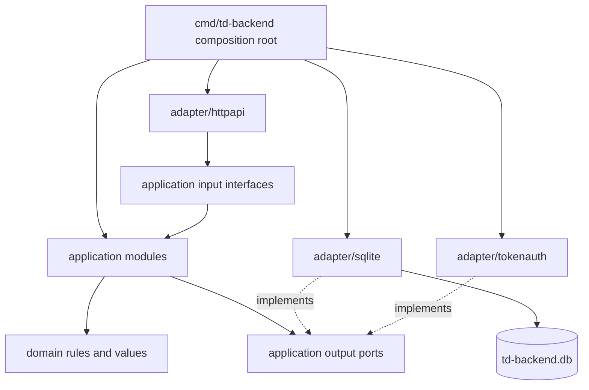
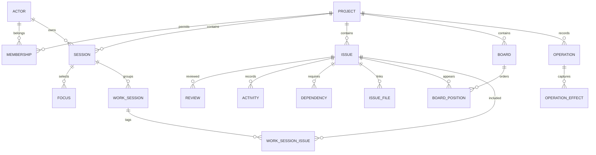
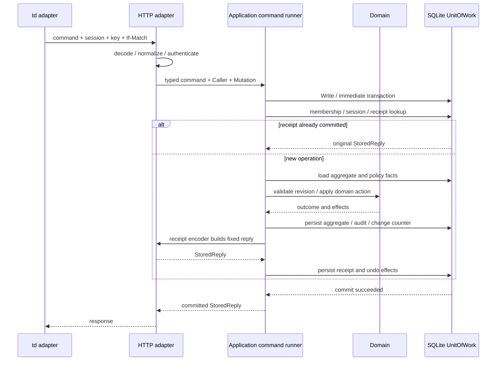

# Go · SQLite · Hexagonal backend 설계

이 문서는 기존 [HTTP 명세](../swagger.json)를 구현할 backend의 설계입니다. 언어는 Go, 저장소는 SQLite이며 domain/application을 HTTP와 SQL에서 독립시킵니다. 설계 상태이고 서버 코드는 아직 없습니다. 도메인 용어는 [CONTEXT.md](../CONTEXT.md), 저장소 결정은 [ADR-0001](adr/0001-single-sqlite-transaction-boundary.md)을 기준으로 합니다.

## 구조와 의존 방향

하나의 Go module `github.com/yoophi/td-backend`와 하나의 서버 binary로 시작합니다. 현재 workspace와 td 소스의 toolchain은 Go 1.27.0입니다. HTTP는 표준 `net/http`, SQL은 `database/sql`, SQLite driver는 CGO가 필요 없는 `modernc.org/sqlite`를 선택합니다. driver의 정확한 버전은 구현 시 go.mod/go.sum에 고정하고 실제 embedded SQLite 버전도 확인합니다. [driver 공식 문서](https://pkg.go.dev/modernc.org/sqlite).



실선은 compile-time dependency와 데이터 흐름, 점선은 interface 구현을 나타냅니다. application은 adapter를 import하지 않습니다. domain은 HTTP DTO, SQL row, driver, logger 및 td의 internal package를 import하지 않습니다. composition root만 concrete adapter를 조립합니다.

| 예정 경로 | 책임 |
| --- | --- |
| `cmd/td-backend/main.go` | config, DB/migration, adapter 조립, HTTP 시작, graceful shutdown |
| `internal/domain` | Issue/Review/Handoff/Board 값, 상태 전이, reviewer/close eligibility, review basis, dependency 규칙 |
| `internal/application/issue` | create/edit/delete/restore, workflow, handoff, review, 관계 변경 |
| `internal/application/project` | project 생성/조회, membership 확인, session 등록 |
| `internal/application/board` | 보드 정의, insertion slot, before-card 이동, visit |
| `internal/application/monitor` | 일관된 조회 snapshot에서 task 분류, focus, activity, stats 조합 |
| `internal/application/note` | 메모 CRUD, pin/archive |
| `internal/application/worksession` | 작업 묶음 시작/종료, tagging |
| `internal/application/operation` | 공통 command 실행, 멱등 receipt, audit, 조건부 undo |
| `internal/application/port` | 트랜잭션·조회·인증·응답 인코딩의 output interface와 기술적 값 타입 |
| `internal/adapter/httpapi` | routes, headers/JSON decode, input 호출, HTTP 오류·DTO·SSE 매핑 |
| `internal/adapter/httpapi/receiptcodec` | 성공 결과를 고정된 wire response로 인코딩; DB commit 전 실행 |
| `internal/adapter/sqlite` | connection pools, SQL repositories, snapshot query, migrations, row mapping |
| `internal/adapter/sqlite/migrations` | 버전/체크섬이 있는 SQL migration |
| `internal/adapter/tokenauth` | bearer token 검증과 Actor 해결 |
| `internal/config` | 환경변수·flags 검증, secret 로깅 방지 |

각 application module은 use case별 typed command/query를 받습니다. endpoint 63개를 하나의 `Execute(map[string]any)`에 넣지 않습니다. 공통 command 실행 module이 중복 검증·receipt·transaction을 숨기고, 개별 module이 domain rules를 적용합니다. interface는 실제 소비자가 필요로 하는 메서드만 정의합니다.

## Domain과 aggregate

| Aggregate / 값 | 소유 데이터와 불변 조건 |
| --- | --- |
| Project | 표시 이름, title 길이 제한, review policy, change counter; name은 identity가 아님 |
| Issue | 작업 필드, attribution, status, comments/logs/handoffs/reviews/files, outgoing dependencies; relation target도 같은 Project |
| Review | append-only 기록; 새로운 결정/작업 내용 변경이 기존 active row를 supersede |
| Board | TDQ 정의, view mode, 명시적 카드 위치; builtin name/query/삭제 제한 |
| Note | 본문, pin/archive, soft deletion |
| Session | Actor ownership, branch/agent/context identity; process path는 서버 데이터가 아님 |
| WorkSession | owning Session, tagged Issues, 시작/종료; 종료 뒤 tagging 변경 제한 |
| Operation | committed intent, 고정된 response, audit effect 및 undo 검사 기준 |

Issue는 저장 revision과 review basis를 분리합니다. `revision`은 aggregate 변경마다 증가하는 optimistic concurrency 값이고, `content_version`은 review를 무효화하는 substantive change에만 증가합니다. log 추가로 aggregate revision이 바뀌었다는 이유만으로 기존 review를 무효화하지 않습니다. 반대로 정책상 substantive edit, dependency/file 변경, 새 handoff는 검토 기준을 다시 계산해야 합니다. Review basis에는 content version과 명시적 handoff ID를 기록하며, close는 현재 기준과 active approval을 다시 비교합니다. 무효화할 변경 목록은 현재 td policy와 parity test로 고정합니다.

`Issue.ApplyTransition(action, policyContext)`는 새 상태와 변경 effect를 반환하는 순수 domain 연산입니다. application이 현재 Issue, 구현 참여 이력, latest handoff, active review, child/dependency 상태를 같은 transaction에서 로드해 context를 구성합니다. SQL adapter가 approval을 임의로 판단하거나 status를 직접 덮어쓰지 않습니다. reviewer eligibility는 현재 td의 trusted/delegated/strict/balanced와 minor 예외를 보존합니다. Actor 인증은 접근 제어이고 Session은 review attribution이며, 별도 actor 기준 정책을 몰래 추가하지 않습니다.

기존 td의 internal Go package는 별도 module에서 직접 import할 수 없습니다. 순수 models/reviewpolicy/workflow/query 규칙을 backend domain으로 필요한 만큼 이식하고 원본 commit 및 LICENSE attribution을 보존합니다. 추후 공통 공개 package 추출은 td 프로젝트에서 별도 변경으로 진행합니다. [기존 순수 review policy](https://github.com/yoophi/td/blob/c64d7873d8f555dd49875e34e6b39ae5257e2e0c/internal/reviewpolicy/policy.go).

## Input interface와 output port

Input은 `IssueCommands.Create/Update/Transition/RecordReview/Handoff`, `BoardCommands`, `ProjectCommands`, `NoteCommands`, `WorkSessionCommands`, `Queries`, `OperationCommands.Undo`로 나눕니다. input 값은 domain IDs와 typed fields를 사용하고 DTO는 HTTP adapter에서 변환합니다. `Caller`는 Actor/Project/Session을 담고, `Mutation`은 operation key, normalized command fingerprint, expected revision을 담습니다.

아래는 설계용 interface 예시입니다. 각 repository는 같은 TxScope에 묶인 typed load/save/append 메서드를 제공하며 `*sql.Tx`를 밖으로 노출하지 않습니다.

```go
// internal/application/port (예시, 실제 코드 아님)
type UnitOfWork interface {
    Write(ctx context.Context, fn func(TxScope) error) error
}

type TxScope interface {
    Access() AccessRepository
    Projects() ProjectRepository
    Issues() IssueRepository
    Boards() BoardRepository
    Notes() NoteRepository
    Sessions() SessionRepository
    WorkSessions() WorkSessionRepository
    Operations() OperationRepository
}

type ReadStore interface {
    Snapshot(ctx context.Context, fn func(ReadSnapshot) error) error
}

type ReadSnapshot interface {
    IssueDetail(ctx context.Context, projectID, issueID string) (IssueDetail, error)
    MonitorFacts(ctx context.Context, query MonitorQuery) (MonitorFacts, error)
    BoardFacts(ctx context.Context, query BoardQuery) (BoardFacts, error)
    ListIssues(ctx context.Context, query IssueQuery) (IssuePage, error)
    // Project/session, stats, notes, activity, operations의 typed read 추가
}

type Authenticator interface {
    Resolve(ctx context.Context, credential string) (Actor, error)
}

type ReceiptEncoder interface {
    Encode(kind CommandKind, outcome Outcome) (StoredReply, error)
}
```

`TxScope`는 transaction 밖에 보관할 수 없습니다. nested UnitOfWork, callback 자동 재실행, network I/O는 금지합니다. repository의 load는 항상 project ID를 받고, Save는 expected revision 조건과 RowsAffected를 검사합니다. read-side SQL은 조회용 facts를 batch로 반환하고 monitor module이 domain eligibility를 평가합니다. 조회 facts에는 board 후보, dependency 상태, session involvement, handoff/review basis가 포함되어 N+1 조회 없이 화면을 조합합니다.

Clock/ID generator는 작은 함수 dependency로 주입합니다. 의미 없는 wrapper interface를 늘리지 않습니다. 시간은 UTC, Project ID는 server-generated `prj_` + UUIDv7, operation key는 client-generated UUIDv4입니다. 상세 형식·충돌·재전송 규칙은 [ID 정책](id-policy.md)을 따릅니다. revision/change token은 opaque 문자열로 노출합니다. error는 domain/application의 typed code이며 HTTP adapter가 400/403/404/409/412/428/503으로 매핑합니다.

`StoredReply`는 status code, 허용된 response headers(Content-Type/ETag), body bytes와 representation version을 담는 application의 기술적 receipt 값입니다. HTTP encoder가 Go outcome을 DTO와 envelope로 변환합니다. domain은 이 값을 알지 못하고 operation runner는 내용 해석 없이 저장·재사용합니다. 완전한 wire replay를 위해 인코딩은 commit 전에 수행하며 Date/request ID 같은 요청별 header는 저장하지 않습니다. 성공 receipt만 보존하고 validation/policy 실패는 rollback합니다. encoder가 실패해도 domain 변경은 commit되지 않습니다.

## SQLite 저장 설계

모든 Project를 `data/td-backend.db` 한 파일에 저장합니다. [sql 초안](sqlite-schema.sql)은 설계를 검증할 수 있는 DDL이며 아직 production migration은 아닙니다.



| 저장 분류 | 테이블 |
| --- | --- |
| 접근 및 context | actors, access_tokens, projects, project_memberships, sessions, session_focus |
| 작업 및 정책 | issues, issue_labels, issue_dependencies, issue_files, issue_reviews, issue_session_history |
| 이력 및 화면 | activities, boards, board_positions, notes |
| 작업 묶음 | work_sessions, work_session_issues |
| 변경 및 복구 | operations, operation_effects, schema_migrations |

Project-scoped 테이블은 `(project_id, id)` 또는 project를 포함한 복합 PK/FK를 사용합니다. 다른 Project의 parent/dependency/file/board position/session/focus/work-session 연결을 DB 차원에서 거부합니다. soft deletion만 공개하고 issue/session을 물리 삭제해 audit 또는 FK를 끊지 않습니다. cycle 검사, status 전이, review basis, title limits는 application/domain에서 검증합니다. unique active-review index와 enum/check/FK는 저장 불변 조건을 보조합니다.

operation effect는 entity kind/ID와 versioned before/after state 및 after-revision을 저장합니다. issue aggregate의 dependent rows를 포함하는 전체 snapshot은 SQLite adapter의 snapshot codec이 만들고, domain command의 changed fields만으로 undo를 복원하지 않습니다. 원본 리뷰·implementation history는 삭제하지 않으며 undo도 새 Operation과 supersession을 추가합니다. 데이터 변경과 audit inverse를 구별합니다.

Focus와 WorkSession도 내부 revision을 가지며 tagging/end/clear가 값을 증가시킵니다. undo 가능한 command는 Issue/Board/Note/Focus/WorkSession 변경으로 한정하고, Project 생성·session 등록·undo 자체의 재-undo는 이 버전에서 409로 거부합니다. operation effect의 polymorphic entity 참조는 adapter가 검사합니다. board position 재배치에서는 UNIQUE 순서 키가 중간 단계에서 충돌하지 않도록 기존 범위 밖의 임시 키를 거친 뒤 최종 sparse key를 저장하며, 두 단계는 같은 transaction 안에 둡니다.

Undo는 되돌릴 업무 필드만 복원하고 revision/content_version/change_seq를 과거 숫자로 되돌리지 않습니다. 모든 변경 aggregate의 현재 revision을 증가시켜 오래된 ETag가 다시 유효해지는 것을 막습니다. creation undo는 soft delete로 표현하며 영향받은 review의 supersession과 참여 history는 보존합니다.

### Connections와 transaction

WAL을 사용하면 읽기와 쓰기가 함께 진행할 수 있지만 같은 파일의 writer는 하나입니다. 초기 배포는 단일 서버 프로세스와 로컬 persistent volume으로 구성합니다. 네트워크 filesystem에서 WAL 파일을 공유하지 않습니다. [SQLite WAL](https://www.sqlite.org/wal.html), [isolation](https://www.sqlite.org/isolation.html).

writer pool은 `MaxOpenConns=1`, `MaxIdleConns=1`, reader pool은 기본 4개로 제한합니다. 둘은 동일 파일을 열되 writer의 transaction mode는 immediate, reader는 deferred snapshot입니다. driver DSN의 `_txlock=immediate`와 `DB.BeginTx`를 사용하고 `sql.Tx`의 Commit/Rollback으로 수명을 관리합니다. Go의 transaction 안에서 별도 DB handle로 SQL을 실행하거나 수동 BEGIN/COMMIT을 섞지 않습니다. [modernc transaction option](https://pkg.go.dev/modernc.org/sqlite#Driver.Open), [Go transaction 지침](https://go.dev/doc/database/execute-transactions).

초기 설정은 `journal_mode=WAL`, `synchronous=FULL`, `foreign_keys=ON`, `busy_timeout=5000`입니다. reader는 추가로 `query_only=ON`을 사용합니다. journal_mode는 migration/startup에서 확인하고 connection별 PRAGMA는 DSN 또는 connection hook으로 **새로 열리는 모든 connection**에 설정합니다. foreign_keys를 하나의 임의 pool connection에만 설정하지 않습니다. reader transaction을 쓰기로 승격하지 않습니다. [foreign key 설정](https://www.sqlite.org/foreignkeys.html), [PRAGMA 문서](https://www.sqlite.org/pragma.html).

WAL-reset 수정이 포함된 embedded SQLite를 사용합니다. 최소 3.51.3 또는 수정 backport를 확인하고 runtime `sqlite_version()`을 기록합니다. 현재 원본 td의 driver 버전을 그대로 복사해 안전한 SQLite 버전이라고 가정하지 않습니다. [SQLite 수정 안내](https://www.sqlite.org/wal.html#walreset).

writer가 lock을 얻지 못하면 busy timeout/request deadline 범위에서 기다리고 최종적으로 503을 반환합니다. application callback을 자동 재실행하지 않습니다. commit 결과가 불명확하면 새 connection에서 receipt를 확인하고 결과를 단정하지 않습니다. client는 원래 key/request로 재전송합니다. 긴 SSE stream은 DB connection이나 read transaction을 점유하지 않습니다.

## Command 실행 흐름



HTTP adapter는 unknown/duplicate JSON fields와 잘못된 header를 거부합니다. fingerprint는 검증된 command의 canonical form, 요청의 API route version(v1), resolved route/project/session, If-Match를 포함합니다. 실행 중인 서버 build나 새 response codec version을 fingerprint에 넣지 않아 upgrade 이후에도 기존 receipt를 찾을 수 있게 합니다. JSON 공백이나 object key 순서만 다르다고 별도 request로 판단하지 않습니다. 배열 순서는 command 의미에 따라 유지합니다.

receipt replay에도 인증과 현재 membership 확인이 필요합니다. write transaction 안에서 receipt를 찾고 같은 key·fingerprint면 저장된 결과를 반환합니다. 다른 fingerprint는 409입니다. receipt lookup을 revision 검사보다 먼저 하므로 첫 write에서 revision이 증가했어도 같은 request를 재전송할 수 있습니다. 새 operation은 expected revision을 검사하고 policy/cascade를 평가한 뒤 모든 변경을 commit합니다.

`POST /v1/projects`는 Project 생성 전이므로 Actor와 `@server` scope로 key를 다룹니다. Project·owner membership·builtin Board·receipt를 동시에 생성합니다. 일반 operation의 scope는 project ID입니다. operation ID는 API의 Idempotency-Key이고 내부 row ID는 별도 server ID입니다. 같은 operation ID가 다른 Actor에 존재할 수 있으므로 operation 조회는 현재 Actor+Project로 해결합니다. 관리자가 다른 Actor의 이력을 조회하는 기능은 별도 API로 명시적으로 설계합니다.

## Snapshot 조회와 이벤트

`ReadStore.Snapshot`은 deferred read transaction을 만들고 첫 SELECT에서 snapshot을 확정합니다. issue list의 records/total/change counter, monitor facts, board 후보와 position을 각각 같은 snapshot에서 조회합니다. page별 change_token은 해당 snapshot의 counter로 생성합니다. page 사이에 token이 바뀌면 Reader adapter가 전체 조회를 다시 시작합니다. monitor의 분류와 close/approve 판단은 같은 domain rule을 사용합니다.

Project는 DB에 `change_seq`를 저장하고 성공한 observable mutation에서 한 번 증가시킵니다. `c-<seq>`를 opaque token으로 반환하며 client는 수치 연산 대신 동일성만 비교합니다. receipt replay에서는 counter를 증가시키지 않습니다.

SSE adapter는 project별 hub를 갖고 짧은 changes query를 일정 간격으로 실행합니다. token이 바뀌면 refresh를 보냅니다. commit 직후 in-process 알림을 latency 개선에 사용할 수 있지만, 알림을 놓쳐도 다음 poll에서 회복합니다. 초기 구현에는 durable outbox와 message broker를 추가하지 않습니다. subscription 전후 token 재확인으로 첫 연결/reconnect의 변경 누락을 막고, 느린 client의 알림은 최신 token으로 합칩니다.

session의 last_activity는 인증된 이용에서 throttle하여 갱신하고 presence는 Clock과 last_activity로 계산합니다. 이 기술적 touch는 review/issue revision이나 change token을 바꾸지 않습니다. 시간 경과에 따른 presence 만료는 token만으로 알 수 없으므로 terminal monitor의 정기 poll을 유지합니다. SSE ping은 화면 변경 신호가 아닙니다. focus의 명시적 변경은 observable mutation이므로 token을 증가시킵니다.

## Bootstrap·운영과 검증

기본 listen은 `127.0.0.1:7000`, DB path는 `./data/td-backend.db`입니다. 환경변수는 `TD_BACKEND_ADDR`, `TD_BACKEND_DB_PATH`, `TD_BACKEND_BOOTSTRAP_TOKEN`을 예정합니다. 초기 token은 외부에서 받아 digest만 access_tokens에 저장하고 bootstrap Actor에 연결합니다. 일반 공개 API에서 token을 발급하지 않습니다. 초기 Actor는 Project를 생성할 수 있고, 이후에는 project membership의 reader/writer/owner를 검증합니다. 자신의 session 등록은 reader도 허용하며 이슈·보드·메모 변경은 writer 이상을 요구합니다.

startup 순서는 config 검증, writer connection 생성, SQLite version/PRAGMA 확인, 배타적 migration, reader pool/application 조립, listen입니다. migration은 schema_migrations에 version/name/checksum/applied_at을 기록하며 이미 적용한 SQL의 변경은 거부합니다. migration 실패 시 listen하지 않습니다.

shutdown은 새 request 수락 중단, SSE cancel, 실행 중 write를 deadline 안에서 drain, DB close 순서입니다. 백업은 SQLite backup API 또는 종료 후 일관된 복사본을 사용합니다. 운영 중 db 파일만 복사해 WAL을 버리지 않습니다. 용량·WAL 크기·write 대기·request latency·503 발생을 관찰합니다.

| 검증 대상 | 필수 시나리오 |
| --- | --- |
| Domain | trusted/delegated/strict/balanced, minor, creator/implementer/history, record-only 이후 close, substantive edit 후 승인 무효화 |
| SQLite | project 간 FK 거부, cycle/active review, 동시 stale revision, 여러 Issue cascade와 undo, receipt 저장 실패 시 rollback |
| 재전송 | 같은 key 동시 요청에서 effect 1회, 다른 body는 409, commit 후 응답 유실·재시작 후 status/body/ETag 일치 |
| Snapshot | monitor 분류와 action eligibility 일치, list page 간 token 변화, board sparse key와 slot 차이 |
| HTTP/SSE | OpenAPI route/DTO, If-Match 412/428, GUI envelope, Last-Event-ID, 느린 client와 reconnect |
| Client 통합 | CLI create/start/handoff/review/close/undo, monitor 편집과 board 조작, serve 경유 GUI와 query/status subprocess |

SQLite integration test는 임시 파일과 실제 Go driver를 사용합니다. in-memory mock만으로 connection/locking/FK 설정을 검증하지 않습니다. domain은 Clock/ID를 고정하여 순수 입력/출력으로 검증합니다. import dependency check로 domain/application에서 adapter 또는 database/sql/net/http로의 의존을 금지합니다.

실행 가능한 DDL 초안은 `python3 scripts/validate_sqlite_design.py`로 검사합니다. 이 검사는 Python SQLite의 제약 조건·transaction을 확인하며, Go driver의 connection 설정이나 실제 application 정책의 검증을 대신하지 않습니다.

구현 순서는 storage/migration/UoW와 project/session → Issue CRUD·receipt → workflow/review/handoff·undo → query/monitor/boards/notes/work sessions/SSE → td client adapters와 GUI 통합입니다. 부분 구현 중에는 `/v1/capabilities`에 완성한 기능만 반환하며 미지원 작업을 성공으로 보고하지 않습니다.
