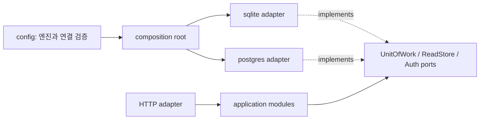

# SQLite / PostgreSQL 엔진 선택 설계

상태: **구현됨(릴리스 전)**. 이 문서는 기존 HTTP 계약과 `td` client를 바꾸지 않고 서버 저장 엔진을 선택하게 만드는 구현 기준이다. `td init --store=td-backend,<URL>`의 `store`는 원격 서버를 뜻하며, 서버의 데이터베이스 엔진 선택과 별개다.

## 목표와 경계

- `sqlite`를 기본값으로 유지한다. 기존 `--db`, `TD_BACKEND_DB_PATH`, SQLite 파일과 migration은 그대로 동작해야 한다.
- 서버 시작 시 `postgres`를 선택하고 PostgreSQL DSN을 제공할 수 있다. 한 서버 프로세스는 한 엔진과 한 데이터베이스에만 연결한다. 여러 Project는 그 데이터베이스 안에서 기존 `project_id`로 격리한다.
- HTTP route, DTO, operation receipt, revision/ETag, review, Undo, monitor, SSE의 의미를 두 엔진에서 같게 유지한다.
- SQLite 파일을 PostgreSQL로 자동 복사하거나 실행 중 엔진을 전환하는 기능은 포함하지 않는다. 기존 데이터 이동은 별도 export/import 설계가 필요하다.

## 설정 interface

| 항목 | SQLite | PostgreSQL |
| --- | --- | --- |
| 엔진 | 기본값 `sqlite`; `--db-engine=sqlite` 또는 `TD_BACKEND_DB_ENGINE=sqlite` | `--db-engine=postgres` 또는 `TD_BACKEND_DB_ENGINE=postgres` |
| 연결 | 기존 `--db` 또는 `TD_BACKEND_DB_PATH`, 기본 `./data/td-backend.db` | `TD_BACKEND_DATABASE_URL` 필수. 예: `postgres://user@db.example/td_backend?sslmode=verify-full` |
| 전용 옵션 | 기존 `--readers`, `--busy-timeout` | 초기에는 보수적인 pool 기본값을 코드에 고정하고 운영 지표를 보고 별도 옵션 추가 |

Flag가 같은 설정의 환경변수보다 우선한다. 엔진 이름은 정확히 `sqlite` 또는 `postgres`만 허용한다. PostgreSQL일 때 명시한 `--db`/`TD_BACKEND_DB_PATH`, SQLite일 때 설정한 `TD_BACKEND_DATABASE_URL`, PostgreSQL일 때 명시한 SQLite 전용 flag는 시작 전에 오류로 처리한다. 기본 SQLite 경로와 옵션은 PostgreSQL 설정 검증에 영향을 주지 않는다. DSN은 CLI flag로 받지 않아 프로세스 인자와 사용 예시에 자격 증명이 나타나지 않게 한다. 연결 오류와 로그에도 DSN·비밀번호를 출력하지 않는다. 인증 token 설정은 두 엔진에서 동일하다.

```sh
# 기존 설치와 동일한 기본값
td-backend --db ./data/td-backend.db

# PostgreSQL: 전용 데이터베이스와 최소 권한 계정을 준비한 뒤 실행
export TD_BACKEND_DB_ENGINE=postgres
export TD_BACKEND_DATABASE_URL='postgres://td_backend@db.example/td_backend?sslmode=verify-full'
export TD_BACKEND_BOOTSTRAP_TOKEN='32자 이상의 기존 또는 신규 token'
td-backend
```

## Module과 seam



`internal/application/port`의 현재 `UnitOfWork.Write`, `ReadStore.Snapshot`, repository interface를 공통 seam으로 사용한다. `internal/adapter/postgres`가 이 interface를 직접 구현하고, `cmd/td-backend`만 `config.Engine`에 따라 concrete store를 연다. 조립 시 필요한 `Close`와 진단 정보는 composition root의 작은 private interface로 둔다. application/domain/HTTP에 SQL dialect 분기나 엔진별 DTO를 넣지 않는다. `modernc.org/sqlite`는 SQLite adapter에만, [pgx의 `database/sql` 호환 driver](https://pkg.go.dev/github.com/jackc/pgx/v5/stdlib)는 PostgreSQL adapter에만 둔다.

SQL 파일은 엔진별로 관리한다. 현재 SQLite SQL에는 `?` placeholder, `INSERT OR IGNORE`, `json_object`/`json_extract`/`json_group_array`, `PRAGMA`가 있으므로 PostgreSQL의 `ON CONFLICT`, JSON 연산과 query를 별도로 작성한다. PostgreSQL adapter 내부의 binder는 정적 SQL의 `?` 인자 표시만 `$1` 형식으로 바꾼다. domain 값 ↔ DB row mapping 중 실제로 같은 순수 변환만 공통화하고, 두 adapter를 얇은 SQL 변환 계층으로 억지로 합치지 않는다. 신규 `postgres.Store`도 모든 port를 compile-time assertion으로 확인한다.

## Schema와 migration

`internal/adapter/postgres/migrations`에 PostgreSQL 전용 번호·이름·checksum migration을 둔다. 기존 SQLite migration 파일은 수정하지 않는다. PostgreSQL에서도 Project 종속 테이블의 `(project_id, id)` PK/FK, receipt의 `(actor_id, scope_key, operation_id)` 유일성, active review/board position 제약을 유지한다. `schema_migrations`를 별도로 기록하고 이미 적용된 migration의 checksum 불일치나 알 수 없는 상위 버전은 startup 실패로 처리한다.

현재 구현은 기존 row codec과 응답 계약을 유지하기 위해 ID·status·policy·UTC 시각을 `text`, revision/change counter와 0/1 boolean을 `integer`, JSON payload를 제약이 있는 `text`로 저장한다. receipt replay의 **응답 body 원본 바이트**는 `bytea`로 저장한다. native `boolean`/`timestamptz`/`jsonb` 변환은 별도 schema migration과 codec 변경이 필요하며 현재 범위에 포함하지 않는다. [PostgreSQL INSERT / ON CONFLICT](https://www.postgresql.org/docs/current/sql-insert.html).

| 제약 범주 | SQLite | PostgreSQL |
| --- | --- | --- |
| Project 소유 데이터 | `(project_id, id)` 복합 키·FK | 동일한 복합 키·FK |
| receipt 중복 방지 | actor/scope/operation 유일 키 | 동일한 유일 키 |
| active review·board position | partial unique index | 동일한 partial unique index |
| enum·points·revision | CHECK 제약 | 동일한 CHECK 제약 |
| JSON payload | `json_valid(...)` CHECK | `IS JSON` CHECK |
| 응답 원본 | BLOB | BYTEA |

동시 startup migration은 PostgreSQL transaction-level advisory lock으로 직렬화한다. lock을 획득한 뒤 migration 상태를 다시 읽어 적용하고 commit 때 lock을 해제한다. 일반 요청에는 이 전역 migration lock을 사용하지 않는다. migration 실패 또는 DB 접속 실패 시 HTTP listen 전에 종료한다. [PostgreSQL advisory lock 문서](https://www.postgresql.org/docs/current/functions-admin.html#FUNCTIONS-ADVISORY-LOCKS).

## Transaction과 오류 계약

`Write`는 PostgreSQL `SERIALIZABLE` transaction, `Snapshot`은 `REPEATABLE READ READ ONLY` transaction으로 구현한다. 이 선택은 SQLite의 단일 writer와 일관된 read snapshot에 대응한다. PostgreSQL의 기본 `READ COMMITTED`에서는 한 transaction의 두 SELECT가 서로 다른 snapshot을 볼 수 있으므로 monitor/list의 일관성에 사용하지 않는다. [PostgreSQL isolation 설명](https://www.postgresql.org/docs/current/transaction-iso.html).

기존 callback 계약처럼 transaction 안에서 network I/O와 중첩 transaction을 금지한다. `40001`(serialization failure), `40P01`(deadlock), lock timeout/연결 장애는 `domain.ErrUnavailable`로 분류하고 **서버가 callback을 자동 재실행하지 않는다**. client는 같은 `Idempotency-Key`와 같은 요청으로 재시도한다. 성공했지만 응답이 유실된 경우 receipt 조회로 동일한 response bytes를 돌려준다. 이미 commit된 business revision 충돌은 기존 409 계약을 유지한다. DB unique/FK 오류는 constraint별로 기존 domain conflict/validation에 매핑하고 SQL 오류 문구를 응답에 노출하지 않는다. [PostgreSQL SQLSTATE](https://www.postgresql.org/docs/current/errcodes-appendix.html).

Project 생성과 bootstrap도 같은 transaction 안에서 actor/membership/builtin board/receipt를 저장한다. 동일 key의 동시 생성은 unique constraint와 client retry/replay로 해결한다. 서버 인스턴스들이 하나의 PostgreSQL DB를 공유한다면 같은 bootstrap token을 사용해야 한다. 동시 시작 시 bootstrap transaction의 serialization failure만 서버 시작 단계에서 제한된 횟수로 재시도한다. 일반 요청의 callback은 자동 재실행하지 않는다. SSE는 기존 change token poll을 사용하므로 다른 프로세스에서 commit한 변경도 다음 poll에 감지할 수 있어야 한다.

## 구현 순서와 완료 기준

1. Config에 엔진 선택·상호 배타적인 연결 설정을 추가하고 기존 SQLite 기본값 회귀를 검증한다.
2. PostgreSQL migration/runner/port adapter를 만들고 schema·constraint parity를 확인한다.
3. 기존 application/HTTP 회귀를 두 엔진에 실행한다. 특히 init 재시도, observed revision, receipt replay, review supersession, cascade, Undo, snapshot/change token, SSE를 비교한다.
4. PostgreSQL 16+ disposable instance를 쓰는 통합 테스트를 추가한다. 두 서버 프로세스가 한 DB를 공유할 때 동시 write, migration startup, token/SSE 관측을 검증한다. CI에서 서비스 컨테이너로 실행하고 로컬에서는 test DB URL을 명시한 경우에만 수행한다. [PostgreSQL 지원 버전 정책](https://www.postgresql.org/support/versioning/).
5. README에 각 엔진의 실행·백업·복구·권한 설정과 데이터 이동 불가 안내를 추가한다. `td` CLI·monitor·serve는 기존 backend URL로 두 엔진을 동일하게 사용할 수 있어야 한다.

운영 환경에서는 SQLite의 DB/WAL 파일 또는 PostgreSQL의 DB 자체를 각 엔진의 표준 방법으로 백업한다. 엔진을 바꿔 빈 DB에 연결하면 기존 Project ID가 자동으로 나타나지 않는다는 점을 startup/운영 문서에 명시한다.
